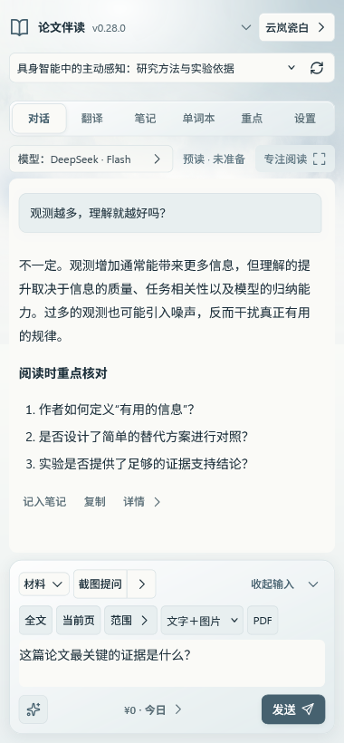
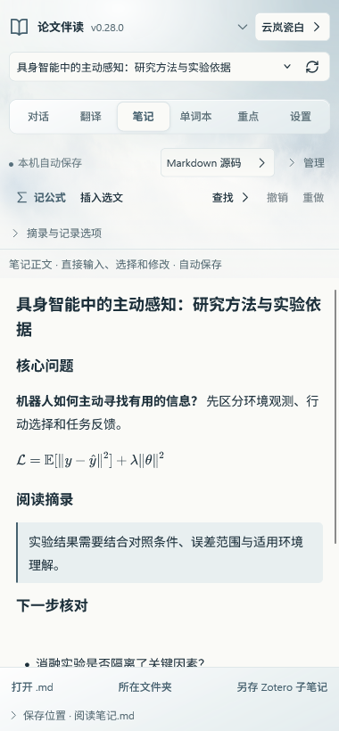

# Paper Companion · 论文伴读

在 Zotero 里读论文、提问、翻译和记笔记。

打开一篇 PDF，就能在侧栏中围绕论文连续提问，把回答、选文、公式和自己的想法记入本篇笔记；遇到的生词进入个人单词本，零散讨论还可以整理成便于回看的重点。

**[下载插件](https://github.com/forguse/zotero-paper-companion/releases/latest/download/INSTALL-LATEST.xpi)** · **[完整使用指南](docs/usage.md)** · [版本记录](CHANGELOG.md) · [反馈问题](https://github.com/forguse/zotero-paper-companion/issues)

 

## 安装

1. 下载 **INSTALL-LATEST.xpi**，无需解压。
2. 在 Zotero 中打开「工具 → 插件」，点击齿轮菜单，选择「从文件安装插件」。
3. 选择下载的 XPI，完成安装后重启 Zotero。
4. 打开一篇 PDF，点击右侧栏的书本图标，或阅读器工具栏中的「伴读」。

面向 Zotero 7–10，目前主要在 **Windows Zotero 10.0.6** 上验证。其他系统和版本仍需更多使用反馈。安装方式和兼容信息见 [Releases](https://github.com/forguse/zotero-paper-companion/releases)。

## 第一次提问

先打开插件的「设置」，选择一种问答方式：

| 方式 | 你需要准备 | 如何使用 |
| --- | --- | --- |
| **DeepSeek API** | 自己的 DeepSeek API Key | 填入并保存，回到对话页选择模型，即可在插件内提问。 |
| **ChatGPT 授权** | 支持相应授权与模型的 ChatGPT 账号 | 点击连接并完成授权，再选择账号提供的可用模型，在插件内提问。 |
| **ChatGPT 网页** | 自己的 ChatGPT 网页账号 | 点击「打开网页」并登录；插件准备问题草稿和材料，由你在网页确认发送。 |

授权模式使用相应的 Work/Codex 额度，与普通网页聊天额度分开。插件不提供公共账号、API Key 或模型额度；在线功能使用你自己的服务及账号额度。

配置好后，回到「对话」，输入一个问题，例如：

> 这篇论文为什么要做？它的方法和实验分别支撑了什么？

默认开启的「智能读论文」会在发送时准备本篇论文的文字依据。发送区的「范围」可展开查看本轮材料；回答中的有效引用可跳回 PDF。需要询问图表或扫描页时，可以附加页面图片或点击「截图提问」，并选择支持图片的模型。[提问与材料说明](docs/usage.md#chat)

问答按论文保留连续上下文。切换论文会切换对应会话和笔记；「新对话」会归档当前会话，需要时可从历史中继续。

**保存 Key 后输入框变空是正常的**：请查看旁边的已保存状态。留空再次保存会保留原 Key，删除需要点击明确的删除按钮。

## 阅读时能做什么

| 页面 | 常用功能 |
| --- | --- |
| **对话** | 连续问答、截图提问、原文检索、全文预读和最多 5 篇论文对比；核对本轮材料，点击引用返回原文。[操作说明](docs/usage.md#reading) |
| **翻译** | 在 PDF 中划词翻译，优先阅读译文；保存原文、译文或双语内容，也可直接写下自己的想法。[操作说明](docs/usage.md#translation) |
| **笔记** | 直接编辑 Markdown，自动保存；支持公式、查找和撤销。截图识别公式为 TeX，可复制或记入本篇笔记。[操作说明](docs/usage.md#notes) |
| **单词本** | 跨论文共用个人词库，查看释义和遇词语境；支持遮住释义自测、本地掌握反馈与到期复习，也可弹出独立窗口。[操作说明](docs/usage.md#vocabulary) |
| **重点** | 把讨论提炼为「聊天重点」，再按需生成「重点再整理」；两份文档分别维护，提示词可修改。[操作说明](docs/usage.md#highlights) |
| **设置** | 分别配置各功能的模型、提示词、保存位置、复习提醒和四套主题；也可打开操作指南或卸载清理。[操作说明](docs/usage.md#connection) |

摘记后会留在当前阅读页，可从回执查看刚保存的内容，或撤销这次摘记。单词本默认每七天提醒复习；原样记录问答和自动维护聊天重点默认关闭，「重点再整理」由你点击更新。

顶部、模型和材料区都可以收起。「专注阅读」把更多空间留给回答，退出后继续编辑原来的草稿。主题与动效可在设置中调整。[外观与阅读空间](docs/usage.md#appearance)

## 笔记和单词本保存在哪里

每篇论文都有独立资料文件夹，默认建在原 PDF 所在位置，包含 PDF 副本和自动保存的 Markdown 文档。原始附件关联保留，也可以在设置中更改资料位置。

在笔记或重点页点击「打开 .md」或文件夹入口，即可用其他软件查看，无需先手动导出。单词本跨论文共用，支持 Markdown 查阅、完整 JSON 备份与导入恢复。[保存位置与备份](docs/usage.md#files)

## 费用与隐私

- 插件采用 MIT 开源许可。在线问答、翻译、公式识别和整理会使用你所选服务的额度；输入区下方可查看金额与明细。ChatGPT 的等效美元是 API 参考估算，不是套餐实际扣款。
- 你选择的提问材料、翻译选文及整理内容会发往对应模型服务。API Key 和授权令牌保存在 Zotero 本机配置中，经本机加密服务保存。
- 仅打开 Zotero 或伴读侧栏不会自动连接模型。本地笔记、词库浏览和公式排版不需要模型；自动翻译、自动整理等功能在你开启后才运行。
- 模型回答、检索结果和预读提要需要结合原文核对。文字预读不覆盖扫描页及复杂图表；引用跳转和页码范围也应以原 PDF 为准。

[费用与余额](docs/usage.md#usage) · [数据发送与服务限制](docs/updates.md)

## 更新与卸载

更新可通过 Zotero 的插件管理器检查，或下载新版 XPI 手动安装，已有设置与资料保留。自动更新需要更新清单和安装包可以直接下载。[更新说明](docs/updates.md)

普通移除插件会保留资料，方便重新安装后继续使用。需要一并清理时，请在移除前打开「设置 → 卸载与清理」，先备份所需内容，再核对清单并确认。原始 PDF、Zotero 文献和归属不明文件保留；空目录、旧迁移位置和手动导出的副本可能需要另行处理。[完整清理范围](docs/uninstall.md)

## 帮助与参与

[常见问题](docs/usage.md#faq) · [反馈问题](https://github.com/forguse/zotero-paper-companion/issues) · [参与开发](CONTRIBUTING.md) · [安全报告](SECURITY.md) · [第三方声明](THIRD_PARTY_NOTICES.md)

反馈时请附上 Zotero 版本、操作系统和复现步骤。截图与日志请先脱敏，勿上传真实密钥、账号配置或私密论文。

本项目采用 [MIT License](LICENSE)，与 Zotero、OpenAI、DeepSeek 官方无隶属关系。
