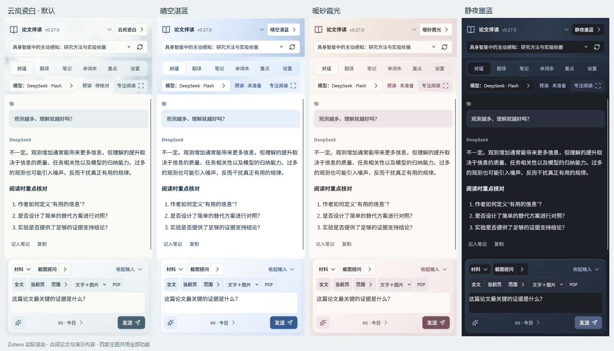
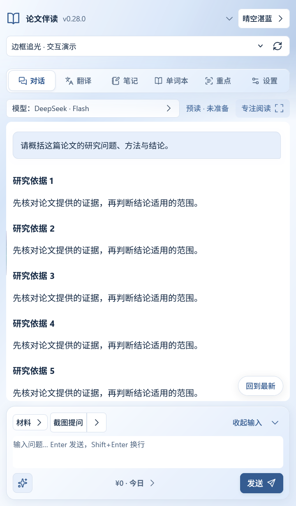

# 四主题与动效规范

使用方法见[外观与阅读空间](usage.md#appearance)。本文供维护者调整颜色、材质、资源加载与交互时参考；边框实现细节见[边框光效](edge-light.md)，布局规则见[对话与阅读交互规格](chat-reading.md)。

## 四套主题

主题身份属于已保存的偏好，名称和颜色可演进，身份不可随意更换。

| 身份 | 名称 | 颜色与材质 |
| --- | --- | --- |
| `cloud` | 云岚瓷白 | 默认。云白、青灰与较深墨色，顶端柔雾向下扩散，乳白玻璃工具层 |
| `blue` | 晴空湛蓝 | 冷白与钴蓝，清楚的蓝白渐变和清透边缘 |
| `warm` | 暖砂霞光 | 暖纸、浅砂和玫灰，柔和透光的渐变工具层 |
| `dark` | 静夜墨蓝 | 炭灰与低亮墨蓝渐变，烟色工具层与深色实底正文 |

新安装及无效主题使用 `cloud`；已有有效选择继续保留。主题切换在主面板、功能页、单词本窗口、划词浮窗和补句提醒之间同步。原生标注色、词条来源区分色以及错误/警告语义保持独立。

## 材质层级

- 顶栏的主题色与柔雾向下淡出，衔接导航和工作区外层，避免把品牌区与回复区分成不相连的色块。
- 渐变和毛玻璃集中在工具层、窗口外层与弹层。正文、笔记、源码和输入区域采用实底，保证阅读和选择文字清楚。
- 云岚柔雾为本项目生成、无损转换后随包缓存的本地 WebP；其他主题使用静态渐变。外观不依赖联网图片，也没有持续运动的背景。素材来源与许可见[第三方组件与素材说明](../THIRD_PARTY_NOTICES.md)。
- 玻璃不可用或高对比度启用时提供有对比度的实色后备。装饰不能降低文字、焦点环或错误提示的可见性。
- 调整材质时同时检查宽侧栏、窄侧栏、独立窗口和 ShadowRoot 浮窗，不能只在单个截图中成立。

## 组件职责

| 模块 | 所有的职责 |
| --- | --- |
| `core.js` | 主题身份、名称、语义色和材质参数 |
| `appearance.js` / `appearance.css` | 偏好应用、选择菜单、键盘导航、渐变/玻璃表面及动效限制 |
| `edge-light.js` | 原边框测量、局部范围、粒子轨迹、遮罩、定时清理与销毁 |
| `ui.js` | 共享图标、控件标签和展开状态 |
| `bootstrap.js` | 随版本变化的 UI 资源包，保证更新后的界面资源一致 |

主题改变只更新令牌和外观状态，不重建笔记或消息正文，不清除草稿、选择位置、滚动位置或未保存的 Key。外观保存经过同一配置队列，成功才提交；失败保留此前已提交偏好。

## 边框追光

追光只改变现有边框区域，包括为容器预留的透明边线，不给正文或整个背景染色。

- 覆盖论文选择区、导航、阅读外框、用户消息、输入区、译文、词卡及相应浮层等容器；普通按钮没有自己的追光目标。
- 鼠标附近约 72 CSS px 的局部范围投影到原边框，四边和实际圆角均需正确处理；不能只在上下边出现。
- 同主题使用有强弱变化的三色粒子。浅色表面采用较深主题色，深色表面采用明亮冷白或暖白，保证实际细线可辨。
- 首次触碰快速亮起，移动时沿边连续响应；离开后约 2.5 秒淡出并清理，不保留永久刷新循环。
- 菜单打开时清理并暂停光效，滚动时重测边界与裁剪，不覆盖文字、菜单选项或可点击目标。
- 动效减少、关闭或高对比度时隐藏追光，并在设置中说明原因。「播放一次」用于主动检查当前设置下的效果。

## 收展和页面切换

页面切换以约 100ms 的轻淡入为主，工具展开/收起约 140ms；短过渡配合立即响应的状态，不让用户等待动画完成后才能操作。折叠前后按钮、图标和焦点位置应稳定。减少动态效果时立即完成状态更新，不留下半透明或被裁切的中间态。

更多菜单使用顶层弹层及兼容回退。选项可通过键盘首尾循环选择，Esc 关闭并恢复合理焦点；不能因为定位或聚焦而滚走 Zotero 宿主侧栏。

## 版本资源一致性

Gecko 可能在同进程升级时保留固定 chrome 地址下的样式和脚本。启动时注册包含插件版本的 UI 资源包，使页面及相对加载的 CSS、JS、字体和图片来自同一版本。旧兼容资源入口继续保留。

新增资源时登记打包白名单，并检查主面板、单词本和原生选区浮窗的加载入口。不通过删除用户缓存、修改插件 ID 或全局刷新 Zotero 缓存处理外观升级。

## 验证要求

- `tests/four-themes-native-harness.js`：四项菜单及键盘循环、保存失败回退、主题跨窗口同步、草稿与正文节点保留。
- `tests/native-appearance-harness.js`、`tests/ui-resources.test.cjs`：真实注册侧栏、全新配置及同进程直接升级、嵌套资源路径一致。
- `tests/edge-light-native-harness.js`、`tests/edge-trail.test.cjs`：四侧物理像素、渐变颗粒、余辉期限、滚动裁剪、菜单暂停和正文区域不变。
- `tests/uiux-native-harness.js`、`tests/polish-native-harness.js`：窄宽布局、缩放、焦点和减少动态效果。

检查使用隔离 Zotero 配置、合成资料和模拟响应；不代表真实模型服务验证。像素差异应结合实际截图观察，不能为通过采样而加粗边框或染色正文。截图是现有原生界面的演示，不是本轮新增概念图。不同系统的玻璃呈现、读屏用户和前台帧率仍需各自环境验证。
