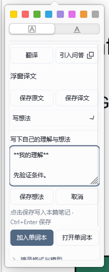
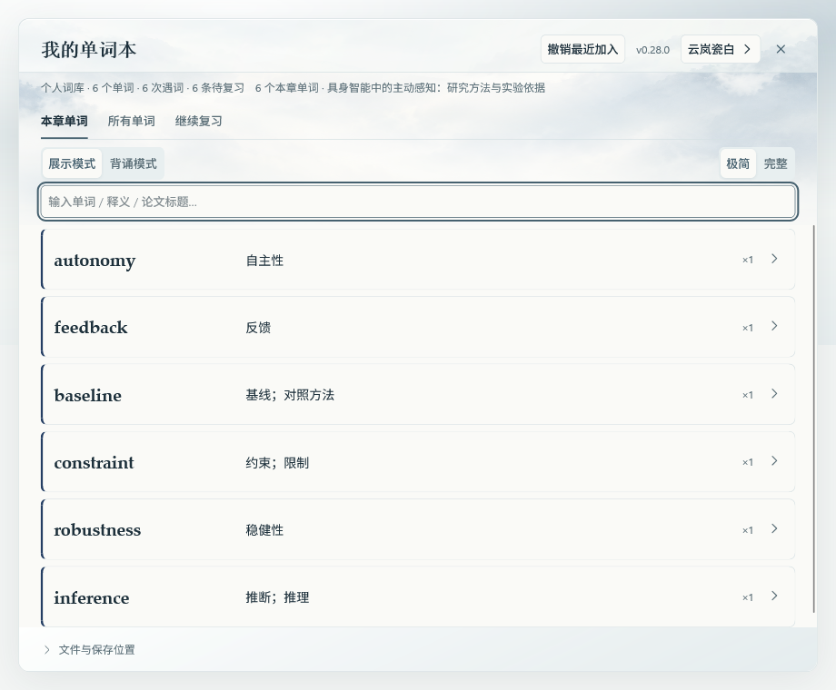
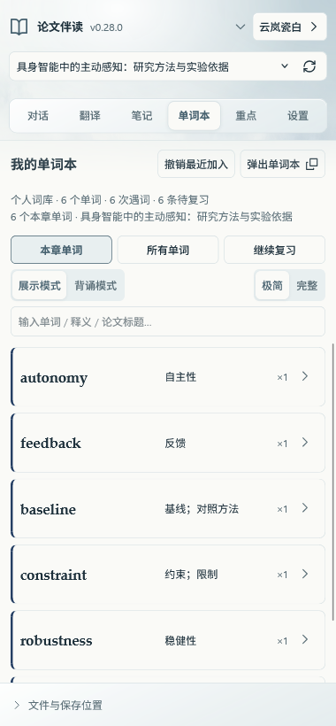
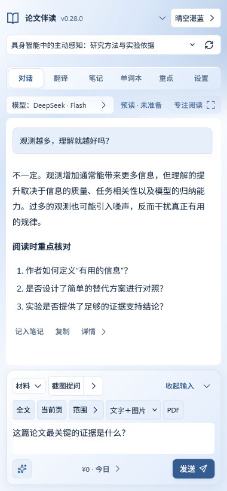
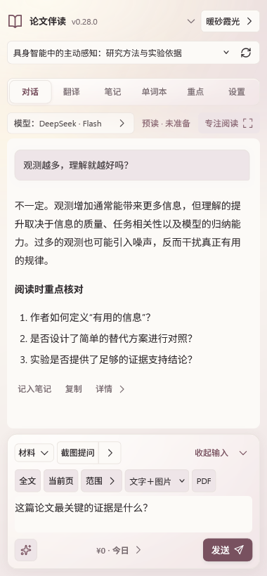
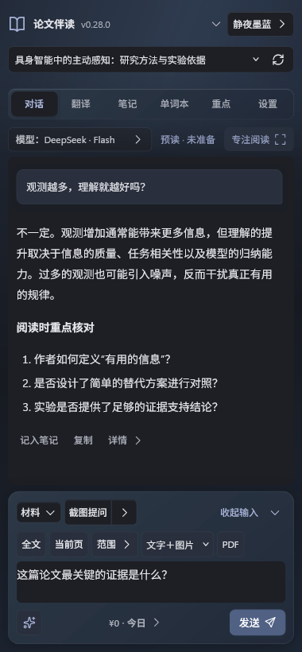

# 使用指南

[返回项目首页](../README.md) · [版本与下载](https://github.com/forguse/zotero-paper-companion/releases) · [反馈问题](https://github.com/forguse/zotero-paper-companion/issues)

先按照首页完成安装，再打开一篇 PDF。主导航中的「对话、翻译、笔记、单词本、重点、设置」分别对应下列流程。本文截图使用演示内容。

- [配置账号与模型](#connection)
- [论文问答与材料](#chat) · [智能阅读与预读](#reading)
- [划词翻译与摘录](#translation)
- [阅读笔记](#notes) · [截图记公式](#formula)
- [个人单词本与复习](#vocabulary)
- [聊天重点与重点再整理](#highlights)
- [文件保存位置](#files)
- [用量、费用与余额](#usage)
- [外观与阅读空间](#appearance)
- [常见问题](#faq)

<a id="connection"></a>

## 配置账号与模型

可以在对话页选择引擎，也可以在设置中保存默认选择。设置首先展示问答方式与账号配置；选择旁会说明回答在哪里出现、是否还需要在网页发送，以及使用哪个账号的额度。「本篇文件夹」可直接定位当前论文的保存位置。

| 引擎 | 使用方式 |
| --- | --- |
| DeepSeek API | 在设置中填写自己的 API Key，然后在插件侧栏中对话。 |
| ChatGPT 网页 | 点击「打开网页」，在内嵌网页中登录，使用网页上的模型和对话。 |
| ChatGPT 授权 | 点击「连接 ChatGPT」完成账号授权，然后在插件中选择可用模型。 |

插件不提供模型账号或公共 API Key。在线问答、翻译和重点整理会使用所选模型服务的额度。ChatGPT 网页与授权模式使用独立的登录会话，用量规则也可能不同，请以相应服务的账户提示为准。

仅打开 Zotero 或伴读侧栏不会自动连接模型。

设置各组会标明保存方式。账号选项、Key、翻译偏好、常用问题和提示词需要明确保存；主题、对话模型和工具偏好等即时选项自动保存。留意就地的待保存、保存中、已保存或失败状态；没有修改时保存按钮禁用。设置中的「操作指南」可查看当前页的入口说明，也可固定最多两个快捷入口；空对话提示可关闭后从指南重新打开。

在「设置 → 各功能使用的模型」可查看当前配置。问答与预读共用一组，翻译、单词释义和文字补句共用一组，公式与原句 OCR 共用图片模型，两份重点共用整理模型。各功能的操作旁也会显示实际模型，点击即可修改；更改问答模型不会连带更改其他组。

保存 DeepSeek API Key 后，输入框会清空，旁边会显示“API Key 已在本机加密保存”。这表示本机保存成功，服务有效性以实际请求为准；留空再次保存会保留原 Key。底部“保存设置”也会保存单词本选项。

<a id="chat"></a>

## 论文问答与材料

发送区的「范围」先说明本轮计划：手动材料、智能检索、可用预读、对比论文及有效历史。展开后可查看上轮实际准备的材料；回答详情也会保留实际依据。已发送前的计划不代表模型已经读过。手动附加材料时默认优先使用它；若还需本篇背景，勾选「同时参考本篇（提要与原文检索）」，不会因此重复上传整篇。

在 PDF 中选中文字，点击浮窗里的「引入问答」，原文就会追加到问题草稿。也可以通过对话页的材料按钮准备更多内容：

| 材料 | 用途 |
| --- | --- |
| 当前页 | 围绕正在阅读的一页提问。 |
| 范围 | 输入起止页，讨论某个章节或几页内容。 |
| 全文 | 准备整篇论文的文字或页面图片。 |
| PDF | 附加完整 PDF，需所选服务支持文件输入。 |

点击材料栏的「截图提问」，在 PDF 页面内拖框，截图会附加到当前问题；按 Esc 取消。旁边的截图选项可开启「同时复制图片」。截图保留原问题，不自动发送；网页已打开时也会尝试附加图片，失败仍保留在插件中。请选用支持图片的模型。

页码以阅读器显示的 PDF 物理页为准。材料可以选择文字、图片或两者，发送前可预览。

可以直接输入纯文字问题，无需先附加材料。切换到 DeepSeek 时，不兼容的历史 PDF 原件或图片不会再次上传，已有问答仍保留，并在问题下方说明。需要核对原文时，可附加「全文 → 文字」或开启智能读论文。本次主动附加的材料仍需当前模型支持。

例如，可以问：“这段推导依赖哪些假设？”“结合当前页解释图中的实验结果。”

插件输入框中按 **Enter** 发送，**Shift + Enter** 换行。使用 ChatGPT 网页模式时，「传入网页草稿」只填写文字；图片和 PDF 通过「附加到网页」交付。网页里的重复文字输入区默认收起，模型、附件和发送按钮保留；点击「展开输入」可以检查草稿，点击「收起输入」继续用插件输入框。传入成功后才清空插件草稿，失败会保留原问题。确认草稿和附件后，再由你点击网页发送。

问答模型为 ChatGPT 授权时，模型旁可选择支持的推理强度，独立于翻译和文档整理设置。默认快速问题提供研究动机、basic idea、设计依据、实验支持及真实价值等六条，仍可在设置中逐行修改。

网页工具栏保留打开、刷新、附加和展开输入；外部打开、放大与关闭在右侧「更多网页操作」中。可按 Esc 收起菜单，所有操作入口仍保留。

对话工具区的“新对话”会归档当前会话；“历史对话”可以查看并继续旧会话，继续前也会保存当前会话。手动更新聊天重点会检查本篇当前和已归档的已完成问答，已经整理的轮次不会重复调用模型。

### 连续阅读与草稿

未发送的问题、材料和问题框选择位置会按论文在当前插件窗口内暂存，切回后可继续；关闭该插件窗口后不保留这些草稿。已发送会话仍自动保存。若本机保存失败，对话区会保留回答并显示「重试保存」；这个按钮只保存当前内容，不重新调用模型。提问以气泡区分，回答直接展示正文；点击回答下方「详情」可查看该轮已记录的模型。生成途中更改模型用于下一次请求。

生成回答时可以向上回看、选择文字或展开来源，界面不会强制拉回底部；点击「回到最新」恢复跟随。模型区的「回答位置与用量」可展开查看引擎说明。


顶部默认收成一行，品牌旁显示当前插件版本。点击显示当前模型的按钮（如「模型：DeepSeek · Flash」），可展开引擎、模型和阅读工具；材料按钮与截图提问保留在输入区。点击「专注阅读」，可临时收起标题、导航和输入区，把空间留给回复；「退出专注」或 Esc 恢复。收起输入保留当前草稿，点击「继续提问」即可接着写。Zotero 原生论文标题仅在此插件的专注状态临时隐藏，离开后恢复。

<a id="reading"></a>

## 智能阅读与预读

对话页默认开启「智能读论文」。没有手动附加材料时，点击发送会在本机提取当前 PDF 的文字并准备阅读依据：较短论文首轮可提供全部可提取文字，后续主要提供与问题匹配的片段。手动选择的选文、页面图片或 PDF 优先保留。关闭开关可恢复完全手动的材料选择。

- **原文检索**：输入术语或问题，在本机检索原文，不调用模型。检索结果可跳转到实际 PDF 页，也可摘录到当前论文笔记。
- **对比论文**：勾选另外几篇已打开的 PDF，最多 5 篇一起提问。每篇原文都有独立标题、来源编号和物理页码；不会合并各篇聊天或笔记。
- **核对依据**：回答前显示本轮提供了全部可提取文字、检索片段还是概览节选，以及是否复用预读提要；检索零命中会明确标注。回答下方可展开「本轮提供的原文」。模型引用已提供的来源编号时，会转换成对应的页码链接；未知编号不会变成可点击的假来源。
- **预览与重建**：可以先预览准备提供的片段，或重建当前论文索引。外部修改 PDF 后请先重新打开阅读器，再重建索引。

提取结果保存为同一资料文件夹中的 `论文原文.md`，检索缓存保存在该文件夹的辅助目录。更改资料位置时一起复制，旧文件保留。打开侧栏不会提取全文或连接模型；首次提问或手动检索才准备索引。

频繁切换论文时，插件限制留在内存中的原文缓存，其他索引仍保存在磁盘，可按需重新读取，不会删除笔记或额外调用模型。多个入口同时读取同一 PDF 时复用本地提取；停止其中一次只退出对应操作，其他仍需要原文的操作可继续。PDF 或资料位置改变后，会重新核对来源。

当前使用本机词法检索与常用中英学术词映射，并非通用跨语言语义检索。未匹配到内容时可尝试英文术语；自动问答可能补充概览片段，并明确标注其覆盖范围。扫描 PDF、复杂图表和公式仍可使用现有页面图片、原始 PDF 和公式截图功能。超过 600 页或 200 万字符的论文会提示改用页码范围，避免无界读取。自动提供的原文会随提问发送到你选择的模型服务。

### 先让模型预读整篇

对话页的预读入口会显示「未准备」「已提取」「已预读」或「需更新」。打开或回到面板时，只检查本机资料与 PDF 是否一致，不提取整篇，也不调用模型；PDF 尚未加载完成时先显示待核对。网页预读与本机提要分开标明。

点击预读入口，先选择「查看范围与预估费用」：这一步只在本机准备文字，显示页数、字符量、分段和费用参考，可以停止，不调用模型。费用参考依据本地价格表与粗略分词计算，推理和实际输出可能增加消耗，不能作为费用上限；无法计价时会明确提示。

确认范围后点击「预读 / 复用提要」，才把整篇可提取文字交给当前问答模型，长文分段读取，保存 `论文预读.md`。后续开启智能阅读时，会复用提要并定位相关原文，减少全文重复发送。已有有效提要直接复用；点击「重新预读」才重新生成，中途停止可保留已完成分段。图表和扫描页不由文字预读识别。

ChatGPT 网页模式对应「传入预读草稿」，仍需自己在网站发送。同一网站对话出现完整回复后才确认已处理，换网站对话不会假设已读。API 的本机提要与网站上下文的区别见[预读说明](updates.md#预读检索与模型上下文)。

<a id="translation"></a>

## 划词翻译与摘录

选中文字后，可以在浮窗中翻译。「保存原文」记录选文，「保存译文」记录翻译结果；两者可分别选择格式。译文支持保留排版、普通文字、引用和代码块，默认保留 Markdown 与公式排版。

翻译页默认只保存译文，也可选择仅原文或原文＋译文。展开「保存格式」分别调整两部分：原文格式与笔记页和浮窗的摘录偏好同步，译文格式独立保存。收起后仍显示当前格式摘要，保存按钮随所选内容变化。

「写想法」展开自己的笔记输入区，支持 Markdown 和公式；点击「保存想法」或按 Ctrl+Enter 写入本篇笔记。它用于记录你的理解，与保存原文、译文用途不同。

原文、译文、公式和检索摘录写入个人笔记时，不再自动附加 PDF 页码、来源链接或时间标题；已有笔记保持原样。摘录仍支持普通文字、代码块和引用格式。浮窗草稿在本次运行内可随选区重建恢复，点击「取消」会清除草稿。



译文到达后自动收起原文和偏好，把主要空间留给翻译结果。可展开原文继续查看或修改。

在「翻译」页可单独选择翻译模型和划词行为，译文语言可在「设置」中调整。自动翻译会在每次划词后调用模型；「浮窗显示译文」只控制结果是否显示在浮窗中。

<a id="notes"></a>

## 阅读笔记

若从其他软件修改了阅读笔记，插件下次保存前会比较版本：先把外部内容保留到论文资料文件夹的 `backups` 中，再保存插件内正在编辑的内容。备份失败时保留原文件与插件草稿，并显示错误；两份正文不会自动合并。

每篇论文使用独立笔记。新笔记只预填文章标题，已有内容原样保留；手动清空后也不会自动补回标题。打开「笔记」页，直接点击正文开始输入。修改会自动保存，支持 Markdown 格式、查找替换、撤销和重做。切换到源码可精确调整格式；源码与正文各自使用完整写作区，内容保持同步。

笔记和两份整理文档一直保存为本篇资料文件夹中的 Markdown 文件，无需导出。在笔记页或重点页点击「打开 .md」可直接打开原文件；也可打开所在文件夹、展开保存位置查看实际路径。未设置 Markdown 默认打开程序时会定位到该文件。「另存副本」只用于额外复制到其他位置。

笔记的「管理」中提供另存副本、清空本篇和撤销清空。「清空本篇」会再确认一次，并保存原文件备份。本次 Zotero 运行中可用「撤销清空」恢复，切换论文、重新打开面板仍保留；真正退出 Zotero 后不再提供上次运行的清空撤销。恢复时会保留清空后新写的内容。

「原样记录问答」默认关闭，手动开启后才把之后的问答追加到阅读笔记中；需要时也可以手动将回答或译文记入笔记。内嵌网页中的回答不自动写入普通笔记。

<a id="formula"></a>

## 截图记公式

点击 PDF 工具栏的「复制公式」，拖框选取公式，识别完成后 TeX 会自动放入剪贴板。直接粘贴到笔记里即可显示为排版公式。

需要预览、修改或自动保存时，打开「笔记 → 记公式」：

1. 在「设置 → 公式识别」选择引擎。默认使用 DeepSeek Flash 和已保存的 API Key；ChatGPT 授权仅列出明确支持图片输入的多模态模型。
2. 点击「截图复制 TeX」「截图记入笔记」或「截图识别预览」，在 PDF 页面上拖框截取公式，松开后识别；按 Esc 取消截图。
3. 检查并按需修改 TeX，点击「复制 TeX」「复制到 Markdown」或「记入笔记」。前者是纯代码，后者会加上 `$$` 定界符，适合直接粘贴到 Markdown。

窗口按获取图片、识别、检查使用三个阶段展示；需要重新截图时，展开「图片与识别选项」。也可以点击「直接输入 TeX」手动编辑和复制。

选择「截图记入笔记」时，框选完成后会自动识别并保存，适合快速连续摘记。公式以 `$$ … $$` 写入该论文资料文件夹中的 `阅读笔记.md`，只保存公式内容，可继续在笔记源码中修改。

笔记、问答和重点文档支持 `$…$`、`$$…$$`、`\(…\)`、`\[…\]` 数学公式。通过公式工具复制的纯 TeX 粘贴到笔记时，会自动补上数学定界符并本机排版，保存和导出仍保留可编辑的 Markdown/TeX。代码块中的 TeX 保持代码。公式显示使用随插件打包的 KaTeX，不需要联网或模型调用。

也可以在公式窗口按 **Ctrl+V** 粘贴系统截图，或选择 PNG、JPEG、WebP 图片，再点击「识别此图」。单张图片不超过 9 MB。外部图片也可记入当前论文笔记，正文只保存公式内容。

打开工具不会调用模型。截图识别会把所选区域交给所选服务并消耗相应额度；失败时不会切换引擎或写入不完整结果。公式识别独立于论文问答历史。

<a id="vocabulary"></a>

## 个人单词本与复习

划选一个单词或短语，点击浮窗中的「加入单词本」。所有论文共用一份个人单词本；**每次主动点击加入才累计次数**，重复划选不会误计数。同一个词在不同论文中的释义、原句、句意和日期分别保留，深色的来源标签帮助区分论文，也能点击跳回原文。

点击主导航中的「单词本」进入独立页面，与笔记等页面同级。点击「弹出单词本」打开可调整大小的完整浮窗，便于集中浏览和复习；两处共用同一份词库与复习进度。

默认使用「展示模式＋极简」：**一行一个单词，中英文同排**，右侧显示个人累计遇词次数；点击箭头原地展开语境，点击词头进入详情。「本章单词」只显示当前论文中加入的词和语境；「所有单词」显示个人完整词库，按字母排列并支持搜索，返回时保留查找位置。词条与搜索框左右对齐。选择「完整」会展开所有词条的语境，首行布局保持一致。切换「背诵模式」后，中文先遮住，点击中文区域才显示，再次点击可重新遮住；释义文字起点、词头与展开箭头的位置保持不变。

点击「继续复习」，从上次确认的位置按语境复习；点击「查看释义与句意」核对理解，再点击「已复习，下一条」保存进度。默认每 **7 天**提醒一次，可在「设置 → 我的单词本与复习」按天、小时或分钟调整，也可关闭；有到期待复习内容时，对话页右上方会出现小提醒。已设置的自定义提醒间隔会保留。

误加后可「撤销最近加入」，或在详情移除某次遇词；「文件与保存位置 → 已移除记录」可恢复。编辑时可更正词头，同名词会合并并保留语境，修改前自动备份词库。纠错、移除和恢复不调用模型。

原句**始终先在本地采集**，优先利用已显示的 PDF 文字，必要时读取并缓存所选页，不把整页交给模型。失败后可选择两条路径：默认的小提醒请你直接补划短句，松手就录入；或自动使用模型文字 / OCR 补采。小提醒每次都提供两种路径和补采方式的切换，无需进入设置，也不抢焦点或挡住选文。手动补划还可开启失败后自动兜底。OCR 会自动读取选词附近的图片，不需要用户再截图；模型文字只处理附近片段。有歧义或无法核对时留空，继续提示补划。

常用释义和语境释义通常在一次请求中补全，使用**翻译设置中的引擎、模型和推理强度**；OCR 自动补采使用公式识别设置中的多模态模型。它们会计入用量。相同句子和选中位置的已有释义可复用；切换模型或语言后重新生成。可在设置关闭「加入时补全释义与句意」，仅本地收藏，之后主动补全。补划、自动补采和补全都不会增加遇到次数。模型不可用时词条与出处仍保留；浏览、搜索和复习不调用模型。

没有原句时以淡灰色名言作占位，明确标注「示例名言 · 非论文原句」。这些示例不会写成真实原句，也不会传给模型。完整流程及名言出处见[单词本说明](vocabulary.md)。

单词本自动维护在 Zotero 数据目录的 `paper-companion/单词本/单词本.md`，通过「文件与保存位置」直接打开 Markdown 或文件夹，也可更改存放位置。更改位置会复制文件，保留旧文件。请在插件内编辑释义；若在其他软件修改 Markdown，下次同步前会先另存一份外部修改备份。单词本属于本机 Zotero 数据目录，不随切换论文或模型账号分开，也不会自动跨设备同步。

换电脑或恢复数据时，在「文件与保存位置」点击 **完整备份 .json**。JSON 包含词条、全部遇词、已移除记录和复习位置，Markdown 用于日常查阅。

点击 **导入 / 恢复备份**，先核对词数、遇词数、重复与冲突及示例内容，再选择合并或恢复。合并保留当前释义和复习位置，新增记录进入待复习；恢复会替换为备份内容及其中的复习位置。两种方式都会先另存当前主数据；同 ID 冲突在合并时保留当前记录。导入支持本插件的完整备份及原始 `vocabulary.json`，单个文件上限 20 MB、十万条遇词；整个过程不调用模型。来源 PDF 仍需另行同步或导入 Zotero。

「继续复习」是跨论文按新增遇词从上次位置向后查看，七天提醒不是对记忆掌握程度的判断。想重看旧词，可回到「本章单词」或「所有单词」，使用背诵模式自测。

复习中可独立选择「自测」或「浏览」。自测先遮挡释义，揭示答案后记录「不会 / 模糊 / 记住」。已评分的语境进入可选的「到期复习」队列；掌握反馈不增加遇词次数，也不调用模型。间隔采用透明的本地规则，不是经过记忆效果验证的算法；原来的新增遇词续接和默认七天提醒继续保留。





<a id="highlights"></a>

## 聊天重点与重点再整理

「重点」页维护两份不同用途的文档：

| 文档 | 记录什么 | 何时更新 |
| --- | --- | --- |
| **聊天重点** | 从已完成的问答中提炼问题、方法、结论与疑点。 | 点击「更新聊天重点」；也可为当前论文开启自动维护，默认关闭。 |
| **重点再整理** | 重新阅读聊天重点，合并重复内容，按主题梳理概念关系和待核对事项，形成复习提纲。 | 只在点击「更新重点再整理」后更新。 |

对话页的「聊天重点」菜单可查看文档并切换本篇的自动维护；也可点击顶部「重点」进入两个独立子页。

可以先积累几轮讨论，再更新聊天重点；等内容较多时，再生成重点再整理。第一份开启自动维护，也不会自动更新第二份。

已经总结过的问答不会重复整理。聊天重点和重点再整理提示词都没有变化时，再次点击「更新重点再整理」也不会重复调用模型。

### 修改提示词

在「设置 → 两份重点文档的提示词」中，可以分别修改两份文档的总结要求，例如希望更简短、侧重公式推导，或优先整理实验设计。

两段提示词都已提供默认内容，支持独立恢复默认。修改后点击「保存两份提示词」即可，程序会自动附上相应材料。保存提示词本身不调用模型。

第一份的新提示词用于后续尚未总结的问答；第二份的新提示词会在下次点击更新时使用。这些设置适用于所有论文。

<a id="files"></a>

## 文件保存位置

默认在原 PDF 所在目录下创建一个以论文标题命名的文件夹：

```text
文章标题/
├── 论文.pdf
├── 阅读笔记.md
├── 聊天重点.md
├── 重点再整理.md
├── 论文原文.md（智能阅读按需生成）
└── 论文预读.md（模型预读后生成）
```

PDF 以副本形式放入文件夹，原文件名保留，Zotero 中的原附件关联继续可用。文件夹中还会保留笔记备份和整理所需的辅助文件。

在「设置 → 本篇论文的资料文件夹」中可以打开文件夹或更改存放位置。选择新位置后，现有资料会复制过去，后续修改保存到新位置，旧文件保留。已有同名文件夹时会自动避让。

Markdown 文件可以用其他编辑器阅读；另存为 Zotero 子笔记则是一份快照，不会与 Markdown 双向同步。

<a id="usage"></a>

## 用量、费用与余额

输入框下方优先显示今日费用：DeepSeek 默认为人民币估算，ChatGPT 授权为等效美元，不是套餐扣款。小额费用显示为「¥<0.01」或「等效 US$<0.01」，其他金额按两位小数显示范围。点击金额可查看完整精度、Token、本篇、累计、分功能记录及单次调用；单价可自定义，未计价部分会注明。

调用明细每页 30 条，可按时间范围、引擎和功能筛选，再用「上一页 / 下一页」浏览。旧记录分段保存在本机，不会因当前页只显示部分记录而丢失；累计金额仍包含符合筛选条件的历史调用。旧版统计会继续读取并按需整理为新存储格式，无需重新开始记账。

ChatGPT 授权模式下可直接点「查套餐额度」，在官方用量页查看账号适用的剩余额度与重置时间。当前插件尚未验证可在插件内读取套餐剩余百分比的接口；限制周期与重置时间以官方页面为准，不固定为五小时或月度。请核对浏览器登录的账号和工作区。DeepSeek 余额仅点击「查询余额」时读取；网页模式的费用无法读取，未知用量不会显示成零。详见[计价与接入说明](updates.md#用量与费用来源)。

<a id="appearance"></a>

## 外观与阅读空间

点击顶部当前主题名称，可随时选择四套外观；顶部收起后入口仍保留。

| 主题 | 风格 |
| --- | --- |
| **云岚瓷白** | 默认主题，云白、青灰柔雾与乳白玻璃 |
| **晴空湛蓝** | 冷白、钴蓝与清透的蓝白渐变 |
| **暖砂霞光** | 暖纸、浅砂与柔和的玫灰渐变 |
| **静夜墨蓝** | 炭灰、墨蓝与低亮度的夜间层次 |

选择自动保存，所有论文共用，已打开的单词本和插件划词浮窗也会同步。主题切换保留草稿、编辑位置和当前页面。新安装默认使用「云岚瓷白」；升级会保留已保存的主题选择，原标准蓝、暖色和夜间对应后三套。渐变与玻璃集中在顶栏、工具区和窗口外层，正文、笔记与输入区域保持清晰实底；云岚的雾光素材随插件提供，无需联网加载。

更新插件后请重启一次 Zotero，让已有窗口加载新资源。

在「设置 → 外观与动效」可选择标准、减少或关闭动效，并单独开关「局部边框追光」。鼠标靠近论文选择区、导航、阅读区、消息、输入区、译文、单词卡片或浮层等容器的边框时，边框本身出现渐变粒子与短暂余辉，离开后约 2.5 秒淡出，正文和背景不变色。普通按钮不单独追光。设置中的「播放一次」可直接演示。减少或关闭动效、系统要求减少动态效果或使用高对比度时，追光会隐藏，设置中会显示原因。

   

<a id="faq"></a>

## 常见问题

**卸载后重装，为什么还记得 API 和账号？**

卸载会移除插件程序，保留 Zotero 本机配置中的账号、密钥和阅读资料，重装后会继续读取。API Key 与授权令牌通过 Zotero 的本机加密服务保存，不包含在 XPI 安装包内。

需要连同这些资料清理时，请在移除插件前打开「设置 → 卸载与清理」，核对具体文件、备份需要的内容，再确认清理。它只处理已登记且归属可确认的文件，原始 PDF 与文献始终保留；空文件夹、旧迁移位置和手动导出副本可能需要另行核对。[完整清理范围与限制](uninstall.md)

要清除 DeepSeek Key，请点击「设置 → DeepSeek API → 删除 Key」。ChatGPT 的「退出账号」会清除当前账号的本机授权并尝试撤销远端令牌；账号名称仍可能保留在列表中，不代表仍然登录。多个账号需要分别退出；普通网页模式需在网页里退出登录。断开连接、卸载和退出账号是不同操作。

**模型会自动读完整篇论文吗？**

默认智能阅读会按问题准备原文，也可先点击模型预读全文文字。只有可提取的文字进入这条流程；图表或扫描页请附加图片。阅读提要和重点再整理都不能代替核对原文。

**为什么网页模式没有直接发出问题？**

这是网页模式的操作方式：插件准备草稿和附件，由你在网页中确认并发送。网页登录受阻时，可以使用「外部打开」，再把导出的材料附加到浏览器对话。

**网页对话能整理成重点吗？**

可以。点击「更新聊天重点」或开启自动维护后，会读取当前网页已加载的完整问答，并交给你选择的整理模型。尚未加载的历史对话不会自动抓取。

**论文内容会发送到哪里？**

问答材料、翻译选文和整理内容会发送给你选择的模型服务。开启自动翻译或自动维护后，相应内容会按该功能的规则发送。请根据论文内容和所用服务自行决定是否使用在线功能。

**没有配置模型，可以记笔记吗？**

可以。手写笔记、摘录、自动保存和查看本地资料不需要模型账号。

**为什么某个公式无法排版？**

公式需要正确的 TeX 语法，并使用 KaTeX 支持的命令。无法解析的内容会保留代码并提示错误，可在 Markdown 源码中修正。插件支持数学公式排版，不编译完整 LaTeX 文档。

**能自动更新吗？**

Zotero 支持通过更新清单下载新版本。更新清单与 XPI 均可在未登录状态下下载时，可使用 Zotero 的更新机制；受限或私有下载源需手动安装。也可以下载新版安装包，在插件管理器中安装更新，已有设置与资料保留。下载源与验收方式见[自动更新说明](updates.md#github-分发能否自动更新)。

